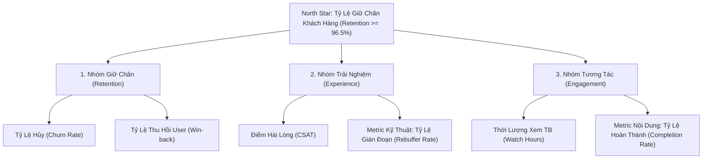

# Báo Cáo Chiến Lược: Thiết Lập Hệ Thống Cảnh Báo & Metric Bổ Sung Cho Netflix Châu Á

* **Vai trò:** Giám đốc Chiến lược (CSO)
* **Phạm vi:** Gói Basic - Châu Á (Dữ liệu T7 - T8)
* **Mục tiêu:** Xây dựng KPI Tree, thiết lập hệ thống cảnh báo Churn Rate và đề xuất 2 metric bổ sung để đảo ngược đà suy giảm.

---

## 1. Bối cảnh & Phân Tích Thực Trạng
Dữ liệu T7 - T8 của gói Basic tại Châu Á phản ánh xu hướng suy giảm rõ rệt:
* **Tỷ lệ Churn:** Tăng từ 4.0% (200.000/5.000.000) lên 5.05% (250.000/4.950.000), tăng tương đối +26.3% chỉ sau 1 tháng.
* **Chỉ số CSAT:** Giảm từ 4.2 xuống 3.8/5.0 (-9.5%), chạm ngưỡng báo động đỏ về độ hài lòng.
* **Thời lượng xem trung bình:** Giảm từ 120 xuống 110 giờ/user/tháng (-8.3%).

Sự sụt giảm đồng thời của CSAT và Giờ xem là dấu hiệu cảnh báo sớm: người dùng không hài lòng với nội dung hoặc chất lượng kỹ thuật, dẫn đến quyết định hủy gói tăng vọt.

---

## 2. Cấu Trúc KPI Tree Cho Mục Tiêu Retention

---

## 3. Thiết Lập Hệ Thống Cảnh Báo Churn Rate (Nhiệm vụ 1)

Để bảo vệ quy mô thuê bao và phản ứng kịp thời, hệ thống cảnh báo Churn Rate được thiết lập theo cơ chế đa tầng:

* **Mục tiêu Chuẩn (Target):** $\le 3.5\%$/tháng.  
  *Căn cứ:* Mức Churn lành mạnh của mô hình SVOD quốc tế tại thị trường mới nổi duy trì trong biên độ 3.0% - 3.5%.
* **Ngưỡng Cảnh báo Vàng (Warning Threshold):** $> 4.2\%$/tháng.  
  *Kích hoạt:* Họp liên bộ phận (Retention, Product, Content) để rà soát lỗi hạ tầng thanh toán và kiểm tra chất lượng kho phim mới phát hành.
* **Ngưỡng Cảnh báo Đỏ (Critical Threshold):** $> 4.8\%$/tháng.  
  *Thực tế T8 (5.05%) đã chạm ngưỡng Đỏ:* Kích hoạt quy trình khẩn cấp:
  1. Triển khai kịch bản giữ chân tự động tại cổng hủy (tạm dừng tài khoản tối đa 2 tháng, voucher giảm 25% cước trong 2 tháng).
  2. Đẩy mạnh đề xuất cá nhân hóa kho phim bản địa thịnh hành.

---

## 4. Đề Xuất 02 Metric Bổ Sung Chuyên Sâu (Nhiệm vụ 2)

### 4.1. Metric Kỹ Thuật (Technical QoE): Tỷ Lệ Gián Đoạn Phát Sóng (Rebuffer Rate)
* **Công thức:**  
  $$\text{Rebuffer Rate (\%)} = \frac{\text{Thời gian màn hình chờ tải (Buffering)}}{\text{Tổng thời gian streaming thực tế}} \times 100\%$$
* **Target & Ngưỡng:** Target $\le 0.3\%$; Ngưỡng cảnh báo $> 0.8\%$.
* **Ý nghĩa:** Hạ tầng mạng tại Châu Á có độ biến động lớn. Gói Basic vốn giới hạn độ phân giải 720p; nếu thường xuyên bị giật lag, CSAT sẽ sụt giảm lập tức. Metric này giúp đội ngũ CDN tối ưu thuật toán nén bitrate thích ứng theo từng nhà mạng địa phương.

### 4.2. Metric Nội Dung (Content Engagement): Tỷ Lệ Hoàn Thành Phim/Tập (Completion Rate)
* **Công thức:**  
  $$\text{Completion Rate (\%)} = \frac{\text{Số lượt xem đạt } \ge 85\% \text{ thời lượng phim/tập}}{\text{Tổng số lượt bắt đầu phát (Starts)}} \times 100\%$$
* **Target & Ngưỡng:** Target $\ge 65\%$; Ngưỡng cảnh báo $< 50\%$.
* **Ý nghĩa:** Giờ xem giảm từ 120 xuống 110 giờ phản ánh người dùng mở app nhưng bỏ xem giữa chừng do nội dung thiếu cuốn hút. Completion Rate là chỉ số đo lường độ gắn kết của kho phim Châu Á (K-Drama, Anime, phim nội địa). Tỷ lệ này giảm đồng nghĩa với việc người dùng sẽ không còn động lực gia hạn gói tháng sau.

---

## 5. Kết Luận
Sự kết hợp giữa hệ thống cảnh báo Churn Rate hai tầng và hai metric bổ sung (Rebuffer Rate, Completion Rate) cho phép Netflix cô lập chính xác nguyên nhân kỹ thuật và nội dung, phục hồi CSAT lên trên 4.2 và đưa tỷ lệ Churn về ngưỡng an toàn dưới 3.5%.
