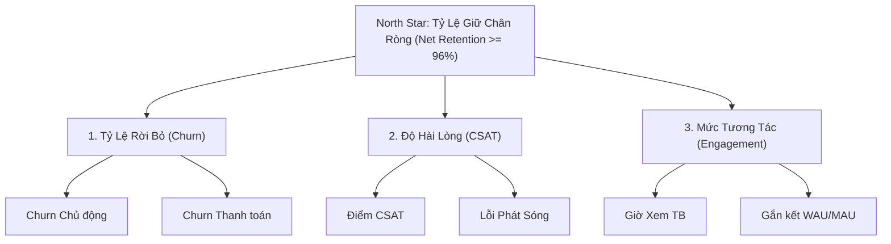

# Báo Cáo Chiến Lược: Xây Dựng KPI Tree & Hệ Thống Đo Lường Giữ Chân Khách Hàng (Retention) Cho Netflix Châu Á

* **Vai trò:** Giám đốc Chiến lược (CSO)
* **Đối tượng:** Gói Basic - Châu Á (Dữ liệu T7 - T8)
* **Mục tiêu:** Kiểm soát tỷ lệ Churn, phục hồi CSAT và duy trì doanh thu thuê bao.

---

## 1. Phân Tích Hiện Trạng & Động Lực Suy Giảm
Dữ liệu T7 - T8 của gói Basic tại Châu Á phản ánh xu hướng suy thoái rõ rệt:
* **Tỷ lệ Churn tăng mạnh:** Từ 4.0% (200.000/5.000.000) lên 5.05% (250.000/4.950.000), tức tăng tương đối +26.3% chỉ sau 1 tháng.
* **CSAT sụt giảm:** Giảm từ 4.2 xuống 3.8/5.0 (-9.5%), chạm ngưỡng báo động đỏ về độ hài lòng.
* **Giờ xem trung bình lao dốc:** Giảm từ 120 giờ xuống 110 giờ/user/tháng (-8.3%).

**Đánh giá:** Thời lượng xem giảm là tín hiệu cảnh báo sớm (Leading Indicator) cho thấy nội dung bản địa hóa thiếu hấp dẫn hoặc chất lượng phát 720p của gói Basic bị cạnh tranh gay gắt, kéo theo CSAT giảm và Churn bùng phát (Lagging Indicator).

---

## 2. Cấu Trúc KPI Tree Cho Mục Tiêu Retention

---

## 3. Hệ Thống Đo Lường - Measurement System (Nhiệm vụ 1)

| Tên chỉ số | Công thức tính | Target | Threshold | Owner |
| :--- | :--- | :---: | :---: | :--- |
| **Tỷ lệ Rời bỏ (Monthly Churn)** | $\frac{\text{Số User Hủy}}{\text{Tổng User Active}} \times 100\%$ | $\le 3.5\%$ | $> 4.5\%$ | Head of Retention |
| **Điểm Hài lòng (CSAT)** | $\frac{\text{Tổng điểm khảo sát}}{\text{Lượt phản hồi}}$ | $\ge 4.2 / 5.0$ | $< 4.0 / 5.0$ | Head of Customer Experience |
| **Thời lượng Xem TB (Watch Time)** | $\frac{\text{Tổng giờ streaming}}{\text{Tổng User Active}}$ | $\ge 125 \text{ h/tháng}$ | $< 115 \text{ h/tháng}$ | Product & Recommendation Lead |
| **Tỷ lệ Gắn kết (WAU/MAU)** | $\frac{\text{Active User Hàng tuần}}{\text{Active User Hàng tháng}} \times 100\%$ | $\ge 60\%$ | $< 50\%$ | Growth Marketing Lead |
| **Tỷ lệ Lỗi Thanh toán (Payment Churn)** | $\frac{\text{User hủy do lỗi thanh toán}}{\text{Tổng User Churn}} \times 100\%$ | $\le 1.0\%$ | $> 1.8\%$ | Head of Payments APAC |

---

## 4. Kịch Bản Business Rule Tự Động Can Thiệp Rời Bỏ (Nhiệm vụ 2)

### Kịch bản 1: Kích hoạt Lại Tương tác Khi Có Dấu Hiệu Lạnh Dần (Pre-Churn Intervention)
* **Điều kiện IF:**  
  `IF` (Thời lượng xem tích lũy của user gói Basic giảm $> 35\%$ trong 14 ngày liên tiếp)  
  `AND` (Không có lượt phát phim mới trong 5 ngày qua)  
  `AND` (Khu vực = "Châu Á")
* **Hành động THEN:**  
  `THEN` Hệ thống tự động kích hoạt chiến dịch giữ chân:
  1. Gửi Push Notification và Email cá nhân hóa gợi ý Top 3 phim thịnh hành bản địa đúng thể loại user yêu thích.
  2. Tặng quyền trải nghiệm miễn phí 7 ngày chất lượng Full HD 1080p (tính năng gói Standard) nhằm kích thích nhu cầu nghe nhìn vượt trội.

### Kịch bản 2: Giữ Chân Khách Hàng Tại Luồng Hủy Dịch Vụ (Cancellation Flow Retention)
* **Điều kiện IF:**  
  `IF` (User gói Basic nhấn "Hủy tư cách thành viên / Cancel Membership")  
  `AND` (Lý do chọn trong khảo sát = "Chi phí chưa tương xứng" HOẶC "Ít dùng")
* **Hành động THEN:**  
  `THEN` Kích hoạt ưu đãi giữ chân trước khi xác nhận hủy:
  1. **Tạm dừng tài khoản (Pause Membership):** Đề xuất tạm dừng tối đa 2 tháng, bảo lưu danh sách My List và lịch sử xem.
  2. **Ưu đãi cước phí:** Cung cấp voucher giảm $25\%$ phí thuê bao trong 2 tháng tiếp theo hoặc gợi ý chuyển sang gói Mobile Plan tiết kiệm $40\%$ chi phí.

---

## 5. Kết Luận & Hành Động Tiếp Theo
Mô hình KPI Tree và Business Rule trên tạo thành vòng lặp tự động khép kín: phát hiện sớm nguy cơ sụt giảm tương tác, chủ động can thiệp bằng ưu đãi nội dung và trải nghiệm, chặn đứng đà rời bỏ của gói Basic tại thị trường Châu Á.
